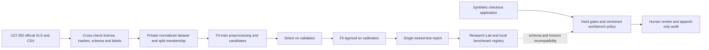

# Data contracts and lineage

| Contract | Identity and scope | Admitted features | Decision-time check |
|---|---|---|---|
| `BenchmarkUCIFeatures` | Dataset 350, Taiwan credit cards, next payment month | Exact `ml/contracts.py` allowlist, 19 integer variables. NTD for limit, bills and payments. Separate categorical status codes. | April–September 2005 history semantics. No per-application timestamp or trustworthy grouping key. |
| `CobiSyntheticApplicationFeatures` | Versioned local synthetic cases, VND | Purchase/principal/own funds, nominal APR, term, monthly income, expenses/debt, four flags, synthetic evidence. | If supplied, timezone-aware evidence event and snapshot must be ≤ submitted time. Undated fixtures are identified as such. |
| `DocumentEvidenceFeatures` | Synthetic evidence only in this release | Counts, source type, verification/permission, confidence of extraction, material failure, feature timestamps. | Extraction confidence and verification are different fields. No empirical defect labels. |
| `HomeCreditFeatures` | Reserved for authorized Kaggle research | Labeled `application_train.csv` with `SK_ID_CURR` as a key only. Additional tables require an approved as-of join contract. | Competition acceptance required. Organizer test labels unavailable. |
| `BankApplicationFeatures` | Reserved for future authorized bank study | Versioned application, feature-event/snapshot, exposure and mature outcome contracts required. | Require feature events/snapshot ≤ decision, observed full outcome horizon or verified event, and label availability before each cohort cutoff. Audit grouping, selection and censoring. |

The last two contracts have no intake, training, or inference path in this release. `data/manifest/restricted-sources.yaml` records the evidence gates.

UCI normalized files retain sample ID solely for split membership and integrity. ID, outcome, and demographics are excluded from predictive columns. Demographics are absent from the normalized file. No name or contact information is present in the verified UCI schema. Raw XLS/CSV, normalized rows, split membership and per-row test predictions remain outside Git. Public aggregate reports and training traces contain no raw applicant rows.

The SHA-256 signature binds ordered feature names, integer types, units, bounds, feature semantics, preprocessing version, source domain and target horizon. JSON requests may order object keys differently. Inference validates the exact set and canonicalizes feature order before transformation. Missing, extra, out-of-range or incompatible inputs fail closed. Numeric bounds are engineering gates, not empirical risk limits. Codes −2 and 0 are preserved as separate categories without assigning undocumented meanings.

SQLite stores effective workbench inputs, latest versioned calculation and immutable audit events under trigger protection. This is local demo persistence. Audit input digests identify the exact effective input snapshot, and the consent event records a state transition. The append-only controls do not protect against a database administrator altering the database outside the application.
