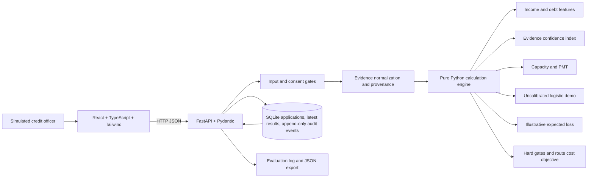

# Architecture

## Request flow

1. `POST /api/applications` validates the synthetic application shape with Pydantic and stores the input record.
2. `calculate_application` checks consent, simulated identity, source permission and funding reconciliation before calculations. A failed mandatory gate returns a hold and null score fields.
3. Financial history is converted into deterministic monthly features. Evidence quality subscores carry their counts, ages, weights and provenance into the response.
4. Affordability, demo PD and expected loss are calculated by pure functions. The policy router filters routes first, then chooses the lowest estimated cost from only the eligible set.
5. The UI presents input values, intermediate values, formulas, assumptions, eligibility, and the recommended review route.
6. Officer actions require an explanation and append a timestamped SQLite event. Database triggers reject updates and deletions to audit rows.
7. What-if runs use a copied input record and return `persisted: false`. JSON export includes the original inputs, calculation output and audit history.

## Trust boundaries

- **Browser:** presentation and temporary scenario editing only. The backend is authoritative for calculations and route eligibility.
- **API:** validates request shapes, enforces the mandatory gates, writes application and audit data, and returns the deterministic outputs.
- **Calculation engine:** does not read or write the database. Thresholds and cost assumptions are passed or imported as demo configuration.
- **Database:** stores only synthetic examples and the latest reproducible assessment/routing result in this MVP. What-if calculations are transient. Append-only triggers protect audit events from edits and deletions through ordinary SQL operations.

## Local services

- Frontend: Vite dev server at `localhost:5173`.
- API and interactive OpenAPI docs: FastAPI at `localhost:8000` and `localhost:8000/docs`.
- Database: SQLite at `backend/data/checkout_credit.sqlite`, seeded from `backend/data/seed_applications.json` on first run.
