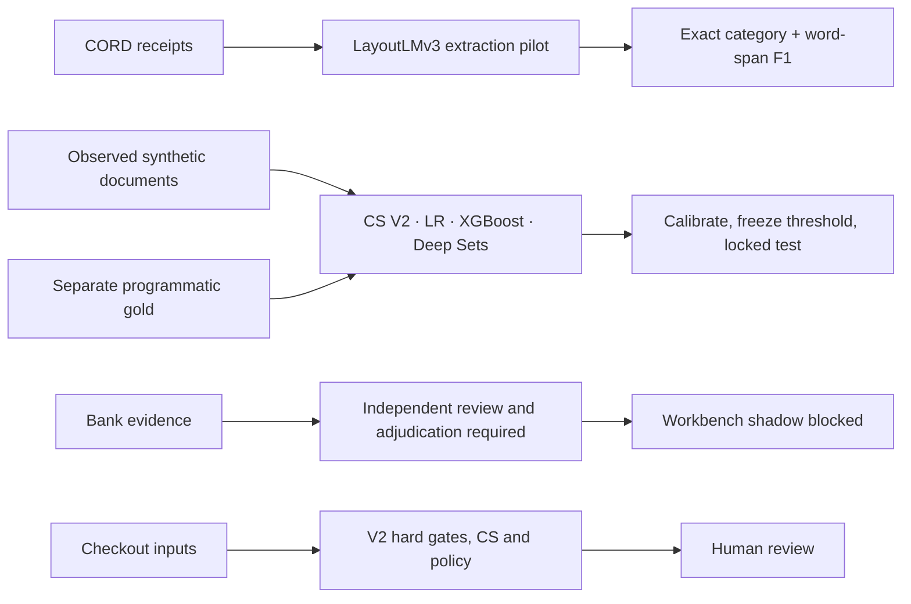

# Slide-ready evidence for COBI V3

## 1. Separate research targets

The existing CS is an interpretable baseline. Bank verification requires independent labels. Extraction and authenticity are separate tasks.

## 2. Controlled test

192 synthetic cases, 753 documents and 200 critical defects in the locked cohort. Deep Sets reached 91.0% critical recall and AP 0.927. XGBoost reached 90.5% recall and AP 0.983. Case workload was 76.6% and 70.8%, respectively. Thresholds were locked at the 90% critical recall target on calibration. [Comparison visual](figures/synthetic_comparison.svg)

## 3. Calibration and ablations

Show reliability with bin counts and paired customer-cluster intervals. Deep Sets had test Brier 0.0740 and log loss 0.2356. Dropping cross-source relationship features raised Deep Sets log loss to 0.3004. Dropping the simple text hash improved it to 0.2160 in this technical study. These are descriptive ablations and do not authorize model selection on the held-out test. [Calibration](figures/synthetic_calibration.svg) · [Ablations](figures/synthetic_ablations.svg)

## 4. Public extraction pilot

The CORD pilot scored 0.626 exact field F1 on 60 sampled receipts. LayoutLMv3 used supplied annotated OCR words and boxes with a trainable final encoder block and field head. Use the per-field chart and label this result as post-OCR receipt extraction. [Field F1](figures/cord_field_f1.svg)

## 5. Bank evidence gate

`EVIDENCE_AI_VALIDATION_BLOCKED`. Retain all V2 gates and human authority. Shadow output on checkout is null until authorized compatible evidence and independent labels exist. [Scientific protocol](../../docs/EVIDENCE_LEARNING_PROTOCOL_V3.md) · [Dataset statuses](datasets.json)
